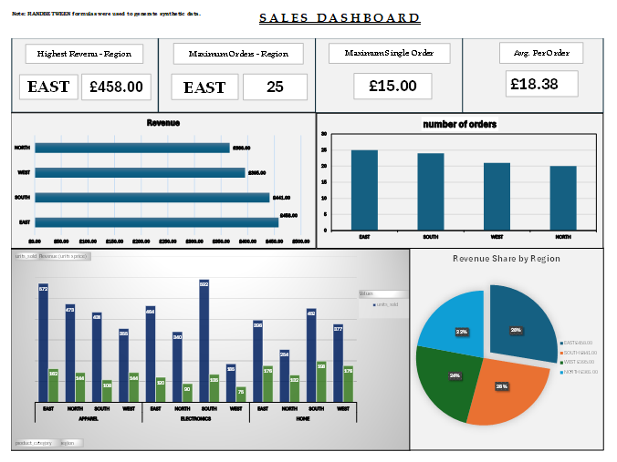

# Sales Dashboard — Excel

An interactive Excel sales dashboard built with a synthetic dataset. The workbook demonstrates spreadsheet-based data summarisation, KPI reporting, lookup formulas and interactive filtering.

> **Data note:** The sales records are synthetic and were generated for demonstration. They do not represent a real company or real customer transactions.

## Preview

[Open the Excel workbook](Sales_Dashboard.xlsx)

## Workbook structure

- **Data:** simulated sales records including order ID, date, region, product category, units sold and unit price.
- **Dashboard:** KPI cards, charts and slicers for exploring the data by region and product category.

## Analysis and Excel techniques

| Area | Techniques used |
|---|---|
| Aggregation | `SUM`, `AVERAGE`, `COUNT`, `COUNTA`, `MAX`, `MIN` |
| Conditional analysis | `IF`, `COUNTIF`, `COUNTIFS`, `SUMIF`, `SUMIFS` |
| Lookups | `INDEX` + `MATCH`, `VLOOKUP` |
| Interactivity | Pivot-table slicers, data validation and controlled input cells |
| Data generation | `INDEX`, `RANDBETWEEN`, `DATE` and `TEXT` |

## Dashboard contents

- KPI cards for highest-revenue region, maximum orders by region, maximum single transaction and average per order.
- Regional revenue and order-count charts.
- Category and regional comparisons for units sold and revenue.
- Revenue share by region.
- Slicers for region and product category.

## What this project demonstrates

- Building an interactive dashboard in Excel.
- Using conditional aggregation and lookup formulas to answer business questions.
- Organising a workbook into source-data and reporting layers.
- Applying data validation and worksheet protection to reduce accidental changes.

## Limitations and next improvements

This is a practice project using generated data, so its results should not be interpreted as real commercial findings. A useful next step would be to add a short written insight section explaining the most important patterns and the business actions a sales manager might consider.

## Files

- [Workbook](Sales_Dashboard.xlsx)
- [Dashboard screenshot](screenshot.png)
